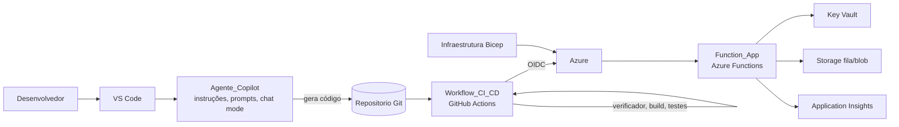
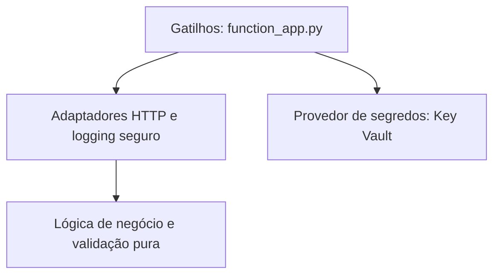

# Design Document

## Overview

O projeto entrega dois artefatos: o **Agente_Copilot** (arquivos de customização do GitHub Copilot, versionados) e o **Projeto_Exemplo** (um Function_App em Python). Também inclui infraestrutura em Bicep, um Workflow_CI_CD no GitHub Actions, o Verificador_Seguranca e a Documentacao em português do Brasil.

### Decisão: linguagem do Projeto_Exemplo e ferramenta de testes por propriedade

**Escolha: Python 3.11 (modelo de programação v2 do Azure Functions), com `pytest` e `Hypothesis`.**

| Critério | Python + Hypothesis | TypeScript + fast-check |
|---|---|---|
| Teste por propriedade | Hypothesis: shrinking maduro, estratégias para texto Unicode, `from_regex`, `builds` | fast-check: bom, mas exige configurar Jest/Vitest e transpilação |
| Round-trip JSON (Req. 5.7) | `json.dumps`/`json.loads` na biblioteca padrão | `JSON.stringify`/`parse` equivalente |
| Verificador_Seguranca | Mesmo idioma do projeto (sem segundo runtime) | Exigiria Node para o verificador |
| Validação sem dependências | Biblioteca padrão basta (`dataclasses`, `re`, `json`) | Normalmente pede `zod` ou similar |
| Simplicidade para aprendizes | Sem etapa de build; `pytest -q` roda direto | Exige `tsc`, `package.json`, bundler |
| Tempo de teste (Req. 5.5, 60 s) | Rápido, sem compilação | Compilação soma ao tempo |

Justificativa: o projeto é educacional e deve ter poucas peças móveis. Python permite escrever o Projeto_Exemplo, o Verificador_Seguranca e os validadores de customização no mesmo idioma, com um único comando de teste e sem etapa de build. O custo é o cold start do Python ser um pouco maior que o de Node, o que é irrelevante para um exemplo didático. A decisão é reversível, porque a lógica de negócio fica isolada dos gatilhos.

Fontes consultadas durante o design, parafraseadas: a documentação do Azure Functions para Python (modelo v2 com decoradores em `function_app.py`), a do Hypothesis (estratégias e `settings(max_examples=...)`) e a do GitHub Copilot sobre `copilot-instructions.md`, `*.instructions.md` com `applyTo`, `*.prompt.md` e `*.chatmode.md`.

## Architecture



Camadas do Projeto_Exemplo (a dependência aponta para dentro):



Estrutura de pastas proposta:

```
.github/
  copilot-instructions.md
  instructions/  (azure-functions.instructions.md, workflows.instructions.md)
  prompts/       (5 arquivos *.prompt.md)
  chatmodes/     (azure-functions.chatmode.md)
  workflows/ci-cd.yml
  dependabot.yml
src/
  function_app.py          # gatilhos (finos)
  app/validacao.py         # validação pura
  app/negocio.py           # lógica de negócio pura
  app/http.py              # mapeamento resultado -> HTTP
  app/logging_seguro.py    # redação de segredos e dados pessoais
  app/segredos.py          # acesso ao Key Vault
  host.json
  local.settings.json.example
  requirements.txt
tests/                     # pytest + Hypothesis
tools/
  verificador_seguranca.py
  validar_customizacoes.py
  validar_documentacao.py
  verificar_rbac.py
infra/  (main.bicep, main.bicepparam)
docs/   (tutorial.md, customizacoes.md, solucao-de-problemas.md)
README.md  ETICA.md  SECURITY.md  LICENSE  .gitignore
```

## Components and Interfaces

### Agente_Copilot
- `copilot-instructions.md`: seções Stack, Estrutura de pastas, Convenções, Comandos de build e teste, regra de Segredos e regra de recusa de código malicioso ou de coleta indevida (Req. 1, 9.6).
- `instructions/*.instructions.md`: um com `applyTo: "src/**/*.py"` e outro com `applyTo: ".github/workflows/*.{yml,yaml}"`.
- `prompts/*.prompt.md`: `criar-http-trigger`, `criar-trigger-temporizador-fila-blob`, `gerar-testes`, `deploy-azure`, `revisar-seguranca`. Cada um declara `description` (até 200 caracteres) e `mode` (`ask`, `edit` ou `agent`). Todos usam placeholders como `<NOME_DO_SEGREDO>`, mandam pedir dados ausentes sem alterar arquivos e proíbem gravar ou repetir Segredos informados no chat.
- `chatmodes/azure-functions.chatmode.md`: `tools` com lista explícita, sem curinga; exige explicação prévia e confirmação explícita antes de ações no Azure; respostas em português do Brasil.

### Projeto_Exemplo (Python)
Interfaces principais, todas puras e sem dependência do runtime:

```python
@dataclass(frozen=True)
class Erro: campo: str; motivo: str

@dataclass(frozen=True)
class ResultadoValidacao:
    valido: bool
    entrada: Optional[PedidoEntrada]
    erros: tuple[Erro, ...]

def validar_texto(valor: object) -> ResultadoValidacao: ...        # nunca lança
def validar_pedido(corpo: bytes) -> ResultadoValidacao: ...         # 413 se > 1 MB
def processar_pedido(p: PedidoEntrada) -> SaidaPedido: ...          # lógica de negócio
def serializar(p: PedidoEntrada) -> str; def desserializar(s: str) -> PedidoEntrada

def tratar_http(req_corpo: bytes, invocacao: str, logger, processar=processar_pedido) -> RespostaHttp
def tratar_evento(payload, invocacao: str, logger, processar=...) -> None   # relança após log
def obter_segredo(nome: str, cliente) -> str                        # sem valor padrão
def redigir(texto: str) -> str                                      # remove segredos e PII
```

Gatilhos em `function_app.py`: `@app.route(auth_level=FUNCTION)` para a função HTTP e `@app.timer_trigger` (ou fila/blob) para a segunda função; ambos delegam a `tratar_http` e `tratar_evento`. O nível de autorização não é `ANONYMOUS` quando a função expõe dados não públicos (Req. 8.11); a rejeição sem credencial (8.12) é feita pelo runtime.

Regras de `tratar_http`:
1. Corpo maior que 1 MB: 413.
2. Campo inválido ou texto com mais de 256 caracteres: 400 com `{"erros":[{"campo","motivo"}]}`; `processar` não é chamado.
3. Válido: 200, `Content-Type: application/json`.
4. Exceção não tratada: log estruturado (`funcao`, `invocacao`, `tipo_excecao`, `mensagem`) e 500 com mensagem genérica.

`tratar_evento` registra o erro com os mesmos campos e relança a exceção, para o runtime aplicar a política de nova tentativa sem encerrar o processo.

### Ferramentas de verificação (`tools/`)
- `verificador_seguranca.py`: varre arquivos versionados (`git ls-files`) em busca de padrões de Segredos (chaves de acesso, connection strings, tokens, chaves privadas) e de Termos_Proibidos (sem diferenciar maiúsculas, em nomes de arquivos, pastas e conteúdo). Imprime `caminho:linha` sem o valor, retorna código diferente de zero se houver ocorrência e zero caso contrário. Não altera arquivos. A lista de Termos_Proibidos fica em `tools/termos_proibidos.txt`, fora da verificação de si mesma por exclusão explícita e documentada.
- `validar_customizacoes.py`: valida frontmatter (`applyTo` presente, não vazio e que casa com ao menos um arquivo; `description` não vazio e de até 200 caracteres; `mode` válido; `tools` explícito sem curinga) e relata caminho e motivo.
- `validar_documentacao.py`: confere que cada arquivo de customização tem entrada em `docs/customizacoes.md` e reporta os que faltam.
- `verificar_rbac.py`: lê o JSON compilado do Bicep e reprova atribuições com escopo de assinatura ou grupo de recursos, e funções Owner, Contributor ou User Access Administrator.

### Infraestrutura (Bicep)
Recursos: Function_App (identidade gerenciada de sistema, `httpsOnly: true`, `minTlsVersion: '1.2'`), plano de hospedagem, conta de armazenamento e Application Insights. Parâmetros: nomes, região e SKU. O RBAC usa o `principalId` da identidade, com escopo no recurso (`scope:` do próprio recurso) e depende da criação dele (`dependsOn` implícito), de modo que não haja atribuição a recurso inexistente. Nenhum Segredo em template ou parâmetros.

### Workflow_CI_CD
Etapas em ordem: checkout, verificador de segurança e de termos, instalação de dependências, compilação (`python -m compileall`), testes (`pytest`), login OIDC (`azure/login` com `client-id`, `tenant-id` e `subscription-id` vindos de `secrets`/`vars`) e publicação. Deploy em job separado com `needs` do job de teste e `environment: production`, que permite revisores obrigatórios. `permissions` somente `contents: read` e `id-token: write`. Dispara em push na branch principal e em pull request (o deploy só roda em push).

## Data Models

```python
@dataclass(frozen=True)
class PedidoEntrada:
    nome_tarefa: str        # 1..256 caracteres
    descricao: str          # 0..256 caracteres
    prioridade: int         # 1..5
    etiquetas: tuple[str, ...]  # até 10 itens de até 32 caracteres

class SaidaPedido: id: str; resumo: str; prioridade: int
class RegistroLog: funcao: str; invocacao: str; tipo_excecao: str; mensagem: str
class Ocorrencia: caminho: str; linha: int | None; categoria: str  # nunca contém o valor
```

JSON de erro: `{"erros":[{"campo":"descricao","motivo":"excede 256 caracteres"}]}`. Dados pessoais cobertos por `redigir`: nome, e-mail, CPF, telefone e endereço (detectados por padrão e por campos conhecidos do modelo).

## Correctness Properties

*A property is a characteristic or behavior that should hold true across all valid executions of a system-essentially, a formal statement about what the system should do. Properties serve as the bridge between human-readable specifications and machine-verifiable correctness guarantees.*

Reflexão: as propriedades de 4.3 e 4.8 (erro 400) foram mantidas em duas, porque 413 e 400 por tamanho têm códigos distintos. 8.3 e 8.4 foram fundidas em uma só (com e sem Segredos), e 11.1 a 11.3 em outra. 1.6, 2.6 e 3.2 viraram uma única propriedade do validador de customizações. Critérios de texto estático (arquivos, workflow, documentação, comportamento do LLM) ficam para testes de exemplo.

### Property 1: Validação total

*For any* texto de 0 a 10.000 caracteres (incluindo Unicode, controle e valores não textuais), `validar_texto` retorna um resultado válido ou inválido sem lançar exceção.

**Validates: Requirements 5.6**

### Property 2: Entrada inválida gera 400 sem vazamento

*For any* corpo de requisição com ao menos um campo ausente, de tipo incorreto ou de formato inválido, `tratar_http` responde 400 com JSON que lista cada campo inválido e o motivo, sem pilha de execução, caminhos de arquivo ou nomes de classes internas, e sem chamar a lógica de negócio.

**Validates: Requirements 4.3**

### Property 3: Limites de tamanho

*For any* corpo com mais de 1 MB, `tratar_http` responde 413; *for any* corpo de até 1 MB que contenha um campo de texto com mais de 256 caracteres, responde 400.

**Validates: Requirements 4.8**

### Property 4: Entrada válida gera 200 JSON

*For any* pedido válido gerado aleatoriamente, `tratar_http` responde 200, com `Content-Type: application/json` e corpo JSON que desserializa sem erro.

**Validates: Requirements 4.4**

### Property 5: Round-trip de serialização

*For any* `PedidoEntrada` válido, `desserializar(serializar(p))` produz um objeto igual a `p`, com todos os campos iguais.

**Validates: Requirements 5.7**

### Property 6: Exceção em função HTTP gera 500 genérico e log estruturado

*For any* tipo e mensagem de exceção lançada pela lógica de negócio, `tratar_http` responde 500 com mensagem genérica que não contém a pilha nem a mensagem da exceção, e registra um log com `funcao`, `invocacao`, `tipo_excecao` e `mensagem`.

**Validates: Requirements 4.5**

### Property 7: Exceção em função não HTTP é registrada e propagada

*For any* exceção lançada pela lógica de uma função de temporizador, fila ou blob, `tratar_evento` registra um log com os mesmos quatro campos e relança a exceção original, sem encerrar o processo.

**Validates: Requirements 4.6**

### Property 8: Logs não contêm Segredos nem dados pessoais

*For any* entrada que contenha Segredos ou dados pessoais (nome, e-mail, CPF, telefone, endereço) em qualquer campo, nenhuma linha de log produzida durante o processamento contém esses valores.

**Validates: Requirements 8.10**

### Property 9: Falha no Key Vault recusa a operação sem valor padrão

*For any* falha do cliente de Key Vault (qualquer tipo de exceção) e qualquer nome de Segredo, `obter_segredo` propaga erro, o log não contém o valor do Segredo e nenhum valor padrão é devolvido.

**Validates: Requirements 8.9**

### Property 10: Verificador de Segredos

*For any* conjunto de arquivos com Segredos injetados em posições aleatórias, o verificador lista o caminho e a linha de cada ocorrência, não imprime o valor do Segredo e retorna código diferente de zero; *for any* conjunto sem padrões de Segredos, retorna zero.

**Validates: Requirements 8.3, 8.4**

### Property 11: Verificador de Termos_Proibidos

*For any* árvore de arquivos com um Termo_Proibido injetado, em qualquer combinação de maiúsculas e minúsculas, no nome de arquivo, no nome de pasta ou no conteúdo, o verificador retorna código diferente de zero, lista o caminho (e a linha, no caso de conteúdo) e não altera nenhum arquivo; *for any* árvore sem termos, retorna zero.

**Validates: Requirements 11.1, 11.2, 11.3**

### Property 12: Validador de customizações

*For any* arquivo de customização gerado com `applyTo` ausente, vazio ou sem correspondência, `description` vazio ou com mais de 200 caracteres, `mode` inválido, ou `tools` vazio ou com curinga, o validador reporta não conformidade com o caminho e o motivo; *for any* arquivo com todos esses campos válidos, não reporta.

**Validates: Requirements 1.6, 2.6, 3.2**

### Property 13: Verificador de RBAC de menor privilégio

*For any* conjunto de atribuições RBAC, o verificador o declara conforme se, e somente se, cada atribuição tem escopo de um único recurso e nenhuma usa Owner, Contributor ou User Access Administrator.

**Validates: Requirements 7.3, 7.8, 7.9**

### Property 14: Verificador de documentação

*For any* conjunto de arquivos de customização e de entradas na documentação, o verificador reporta exatamente os arquivos de customização sem descrição.

**Validates: Requirements 10.3, 10.8**

## Error Handling

| Situação | Comportamento |
|---|---|
| Corpo acima de 1 MB | 413, sem ler o corpo inteiro |
| JSON malformado, campo ausente, tipo ou tamanho inválido | 400 com `erros[{campo, motivo}]` |
| Exceção na lógica HTTP | Log estruturado e 500 genérico |
| Exceção em temporizador, fila ou blob | Log estruturado e relança para a política de nova tentativa |
| Falha no Key Vault | Log sem valor, operação recusada, sem valor padrão |
| Falha OIDC ou de publicação no CI | Job falha com a etapa identificada, sem exibir Secrets |
| Verificador encontra Segredo ou termo | Código de saída diferente de zero, build e deploy não executam |
| Falha de implantação Bicep | Relata recurso ou parâmetro; atribuições RBAC dependem do recurso, então não ficam órfãs |

## Testing Strategy

**Abordagem dupla.** Testes de exemplo cobrem estrutura e conteúdo estático; testes de propriedade cobrem a lógica com entrada variável.

**Biblioteca:** `Hypothesis` com `pytest`. Nada de gerador próprio. Cada propriedade é implementada por **um único** teste `@given`, com `@settings(max_examples=100)` no mínimo e sem acesso à rede ou ao Azure. Cada teste leva um comentário de rastreio no formato `# Feature: serverless-ai-agent-azure-functions, Property N: <texto>`.

**Testes de exemplo e fumaça (`pytest`):**
- Existência e conteúdo: `copilot-instructions.md` (quatro seções, regra de Segredos, regra de recusa), cinco prompt files (um por tarefa, placeholders, instrução de pedir dados ausentes), chat mode (escopo, confirmação, português), `.gitignore`, `SECURITY.md`, `ETICA.md` (quatro seções e link no README), `LICENSE`, `dependabot.yml`.
- Projeto_Exemplo: presença de funções HTTP e de temporizador/fila/blob, `host.json`, `local.settings.json.example` só com placeholders, `auth_level` diferente de `ANONYMOUS`; casos de sucesso (200) e de falha (400) por função HTTP.
- Workflow (análise estática do YAML): ordem das etapas, `permissions`, ausência de IDs literais, OIDC sem client secret, verificador antes do deploy, `environment: production`, `needs` entre jobs.
- Bicep: `bicep build` e checagem do JSON compilado (recursos exatos, identidade gerenciada, `httpsOnly`, TLS 1.2, parâmetros, ausência de Segredos), seguida de `verificar_rbac.py`.
- Documentação: seções do README e do tutorial, 6 pré-requisitos com link, mínimo de 5 problemas em solução de problemas, custo em USD e comando de remoção, aviso de independência (Req. 11.6), diagrama Mermaid validado com `mermaid-cli`.

**Testes de integração (manuais ou em ambiente próprio):** `what-if` e implantação do Bicep, OIDC real, aprovação de revisor no GitHub Environment e rejeição de requisição sem chave (Req. 8.12).

**Fora de teste automatizado:** o comportamento do modelo de linguagem diante de pedidos maliciosos ou de Segredos informados no chat (Req. 2.7 a 2.9 e 9.7). O design cobre apenas a presença das instruções, verificada nos testes de exemplo, e a revisão humana descrita em `ETICA.md`.

**Metas de execução:** `pytest -q` roda sem credenciais, retorna 0 quando tudo passa e diferente de 0 com os nomes dos testes que falharam, em até 60 segundos.
