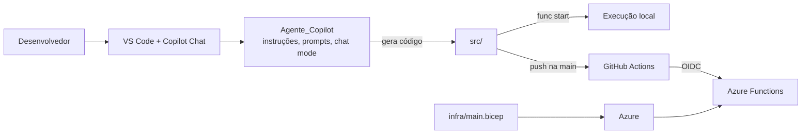

<div align="center">

# ⚡ Agente Copilot para Azure Functions

**Crie, teste e publique funções serverless no Azure com o GitHub Copilot, usando instruções, prompts e um chat mode versionados no repositório.**

[](https://www.python.org/)
[](https://learn.microsoft.com/azure/azure-functions/)
[](https://github.com/Gtvnv/Serveless_IA/actions)
[](tests/)
[](LICENSE)

</div>

> [!NOTE]
> Este projeto é **material de estudo independente**. Não possui afiliação, patrocínio ou endosso de qualquer organização educacional.

## Índice

- [Visão geral](#visão-geral)
- [Pré-requisitos](#pré-requisitos)
- [Início rápido](#início-rápido)
- [Estrutura de pastas](#estrutura-de-pastas)
- [Arquitetura](#arquitetura)
- [Agente Copilot](#agente-copilot)
- [Segurança e ética](#segurança-e-ética)
- [Documentação](#documentação)
- [Licença](#licença)

## Visão geral

Este repositório mostra como usar o GitHub Copilot, com arquivos de customização versionados, para desenvolver e publicar uma aplicação serverless em Azure Functions.

| Recurso | O que oferece |
|---|---|
| 🤖 **Agente Copilot** | Instruções do repositório, instruções por escopo, 5 prompt files e um chat mode dedicado a Azure Functions, em `.github/` |
| 🐍 **Projeto de exemplo** | Function App em Python 3.11 (modelo v2) com uma função HTTP e uma função de temporizador, com a lógica isolada dos gatilhos |
| 🧪 **Testes** | `pytest` e `Hypothesis`, sem credenciais e sem acesso ao Azure |
| 🏗️ **Infraestrutura como código** | Bicep em `infra/`, com identidade gerenciada, HTTPS, TLS 1.2 e RBAC de menor privilégio |
| 🚀 **CI/CD** | GitHub Actions com login OIDC e verificações de segurança antes do deploy |
| 📚 **Documentação** | Tutorial passo a passo, avisos éticos e política de segurança |

Antes de usar o Copilot neste projeto, leia o [ETICA.md](ETICA.md). O passo a passo completo está em [docs/tutorial.md](docs/tutorial.md).

## Pré-requisitos

| # | Ferramenta | Para que serve |
|---|---|---|
| 1 | **Conta Azure** | Hospedar o Function App |
| 2 | **Assinatura do GitHub Copilot** | Usar o agente, os prompts e o chat mode |
| 3 | **Visual Studio Code** (VS Code) | Editor com a extensão do Copilot |
| 4 | **Azure Functions Core Tools** | Executar as funções localmente (`func start`) |
| 5 | **Azure CLI** | Provisionar a infraestrutura e acompanhar o deploy |
| 6 | **Git** | Versionar o código e abrir Pull Requests |

Para rodar os testes, instale também o **Python 3.11**. Os links oficiais de download e cadastro de cada item estão em [docs/tutorial.md](docs/tutorial.md).

## Início rápido

Execute os comandos na raiz do repositório.

**1. Clone e instale as dependências**

```powershell
git clone https://github.com/Gtvnv/Serveless_IA.git
cd Serveless_IA
pip install -r requirements-dev.txt
pip install -r src/requirements.txt
```

**2. Rode os testes** (não exigem credenciais nem acesso ao Azure)

```powershell
python -m pytest -q
```

**3. Configure o ambiente local**

Copie `src/local.settings.json.example` para `src/local.settings.json` e substitua os placeholders. Esse arquivo não é versionado: nunca coloque Segredos no repositório.

**4. Inicie o Function App**

```powershell
cd src
func start
```

Para criar funções com o Copilot, publicar no Azure e resolver problemas, siga o [tutorial](docs/tutorial.md).

## Estrutura de pastas

```text
.
├── .github/
│   ├── copilot-instructions.md   # Diretrizes gerais do Copilot
│   ├── instructions/             # Instruções por tipo de arquivo
│   ├── prompts/                  # Prompt files reutilizáveis
│   ├── chatmodes/                # Chat mode de Azure Functions
│   ├── workflows/ci-cd.yml       # Pipeline de CI/CD
│   └── dependabot.yml            # Atualização semanal de dependências
├── src/
│   ├── function_app.py           # Gatilhos (HTTP e temporizador)
│   ├── app/                      # Validação, negócio, HTTP, segredos e logging seguro
│   ├── host.json
│   ├── local.settings.json.example
│   └── requirements.txt
├── tests/                        # Testes unitários e de propriedade
├── tools/                        # Verificadores de segurança, RBAC, customizações e documentação
├── infra/                        # main.bicep e main.bicepparam
├── docs/                         # Tutorial, customizações e solução de problemas
├── ETICA.md                      # Avisos éticos sobre o uso de IA
├── SECURITY.md                   # Política de segurança
└── LICENSE
```

## Arquitetura



A lógica de negócio fica em `src/app/` e não depende do runtime do Azure Functions. Os gatilhos em `src/function_app.py` apenas adaptam a entrada e delegam. Por isso os testes rodam sem infraestrutura.

## Agente Copilot

Use o chat mode **azure-functions** e invoque os prompts digitando `/` seguido do nome:

| Prompt | O que faz |
|---|---|
| `/criar-http-trigger` | Cria uma função HTTP com validação e teste |
| `/criar-trigger-temporizador-fila-blob` | Cria uma função de temporizador, fila ou blob |
| `/gerar-testes` | Gera testes para uma função existente |
| `/deploy-azure` | Verifica os pré-requisitos e conduz o deploy |
| `/revisar-seguranca` | Lista achados de segurança com risco e correção |

Se faltar informação obrigatória, o agente pergunta antes de gerar ou alterar arquivos. A descrição de cada customização está em [docs/customizacoes.md](docs/customizacoes.md).

## Segurança e ética

- Segredos ficam somente em variáveis de ambiente, App Settings ou Azure Key Vault, nunca no código.
- O deploy usa OIDC, sem client secret, e o RBAC é restrito ao escopo de cada recurso.
- `python tools/verificador_seguranca.py` roda no CI antes do build e do deploy.
- Todo código gerado por IA deve ser revisado por uma pessoa antes de ser executado ou implantado. Veja o [ETICA.md](ETICA.md).
- Para reportar vulnerabilidades, consulte o [SECURITY.md](SECURITY.md).

## Documentação

- [Tutorial completo](docs/tutorial.md)
- [Customizações do Copilot](docs/customizacoes.md)
- [Solução de problemas e custos](docs/solucao-de-problemas.md)

## Licença

Distribuído sob a licença MIT. Consulte o arquivo [LICENSE](LICENSE).