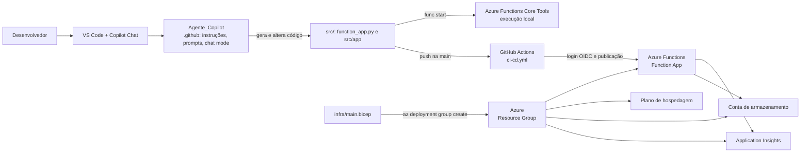

# Tutorial: criar, testar e publicar Azure Functions com o Agente Copilot

Este tutorial conduz você, passo a passo, pelo uso do Agente_Copilot (as customizações do GitHub Copilot versionadas neste repositório) para criar, testar e fazer deploy de funções serverless no Azure Functions. O projeto é material de estudo independente, sem afiliação, patrocínio ou endosso de qualquer organização educacional.

> **Antes de começar:** todo código gerado por IA deve ser revisado por uma pessoa antes de ser commitado, executado ou implantado. Leia o [ETICA.md](../ETICA.md) e use apenas assinaturas Azure que você possui ou tem autorização formal para usar.

## Arquitetura

O diagrama mostra como as peças se relacionam. No VS Code, o Copilot Chat carrega o Agente_Copilot (instruções, prompts e chat mode de `.github/`). O agente gera e altera o código das funções em `src/`. O deploy ocorre pelo GitHub Actions (`ci-cd.yml`), que autentica no Azure por OIDC e publica o Function App.



## Pré-requisitos

| # | Pré-requisito | Link oficial |
|---|---------------|--------------|
| 1 | Conta Azure | [Criar conta gratuita do Azure](https://azure.microsoft.com/free/) |
| 2 | Assinatura do GitHub Copilot | [Planos do GitHub Copilot](https://github.com/features/copilot/plans) |
| 3 | Visual Studio Code | [Download do VS Code](https://code.visualstudio.com/download) |
| 4 | Azure Functions Core Tools | [Instalar o Core Tools](https://learn.microsoft.com/azure/azure-functions/functions-run-local#install-the-azure-functions-core-tools) |
| 5 | Azure CLI | [Instalar a Azure CLI](https://learn.microsoft.com/cli/azure/install-azure-cli) |
| 6 | Git | [Download do Git](https://git-scm.com/downloads) |

Também é necessário Python 3.11, a versão usada pelo Projeto_Exemplo.

## 1. Configurar o ambiente

1. Clone o repositório e entre na pasta (use a URL do seu repositório):

   ```bash
   git clone <URL_DO_SEU_REPOSITORIO>
   cd <PASTA_DO_REPOSITORIO>
   ```

2. Crie e ative um ambiente virtual e instale as dependências:

   ```bash
   python -m venv .venv
   # Windows (PowerShell): .venv\Scripts\Activate.ps1
   # Linux/macOS: source .venv/bin/activate
   pip install -r src/requirements.txt -r requirements-dev.txt
   ```

3. Abra a pasta no VS Code e instale as extensões **GitHub Copilot**, **GitHub Copilot Chat** e **Azure Functions**. Entre com a conta que tem a assinatura do Copilot.

4. Crie o arquivo de configuração local a partir do exemplo. O arquivo `src/local.settings.json` não é versionado (está no `.gitignore`):

   ```bash
   cp src/local.settings.json.example src/local.settings.json
   ```

   Substitua os placeholders (`<SUBSTITUIR_PELA_CONEXAO_DO_ARMAZENAMENTO>`, `<NOME_DO_COFRE>`, `<SUBSTITUIR_PELA_CADEIA_DE_CONEXAO>`) apenas no arquivo local. Nunca coloque valores reais no `.example`, no código ou em workflows.

5. Confirme que tudo funciona:

   ```bash
   python -m pytest -q
   ```

## 2. Usar o Agente_Copilot

O Agente_Copilot é composto por arquivos em `.github/`. O VS Code os reconhece automaticamente ao abrir a pasta. A descrição completa de cada arquivo está em [customizacoes.md](customizacoes.md).

| Arquivo | Para que serve |
|---------|----------------|
| `.github/copilot-instructions.md` | Diretrizes gerais: stack (Python 3.11, modelo v2), convenções, comandos de build e teste, regras de segredos e recusa de código malicioso. |
| `.github/instructions/azure-functions.instructions.md` | Instruções aplicadas aos arquivos de código das funções. |
| `.github/instructions/workflows.instructions.md` | Instruções aplicadas aos arquivos `.yml` e `.yaml` de `.github/workflows`. |
| `.github/chatmodes/azure-functions.chatmode.md` | Modo de chat especialista em Azure Functions, com ferramentas listadas e confirmação obrigatória antes de ações no Azure. |
| `.github/prompts/criar-http-trigger.prompt.md` | Cria uma função HTTP com teste associado. |
| `.github/prompts/criar-trigger-temporizador-fila-blob.prompt.md` | Cria uma função com trigger de temporizador, fila ou blob. |
| `.github/prompts/gerar-testes.prompt.md` | Gera testes para uma função existente. |
| `.github/prompts/deploy-azure.prompt.md` | Verifica pré-requisitos e conduz o deploy. |
| `.github/prompts/revisar-seguranca.prompt.md` | Revisa a segurança de uma função e lista os achados. |

**Como usar:**

1. Abra o Copilot Chat (`Ctrl+Alt+I`).
2. No seletor de modos, escolha **azure-functions** (o chat mode deste repositório). Ele responde em português do Brasil e atua só em Azure Functions.
3. Invoque um prompt digitando `/` seguido do nome do arquivo, sem a extensão `.prompt.md`. Exemplo:

   ```text
   /criar-http-trigger
   ```

   Se faltar alguma informação (por exemplo, o nome da função), o agente pergunta antes de gerar ou alterar arquivos.

4. Revise o código proposto antes de aceitar. Nunca cole segredos, dados pessoais ou código proprietário no chat. Use placeholders como `<NOME_DO_SEGREDO>`.

## 3. Criar funções

O Projeto_Exemplo fica em `src/` e já traz duas funções declaradas em `src/function_app.py`:

- `pedidos_http`: trigger HTTP (`POST /api/pedidos`, nível de autorização `FUNCTION`).
- `rotina_temporizador`: trigger de temporizador, executada a cada 5 minutos.

Os gatilhos são finos e delegam aos módulos de `src/app/`:

| Módulo | Responsabilidade |
|--------|------------------|
| `src/app/validacao.py` | Validação de entrada (tipos, tamanhos, limite de 1 MB). |
| `src/app/negocio.py` | Regra de negócio, sem dependência do runtime do Azure Functions. |
| `src/app/http.py` | Adaptadores HTTP e de eventos: códigos 200, 400, 413 e 500. |
| `src/app/segredos.py` | Leitura de segredos do Azure Key Vault por Identidade Gerenciada. |
| `src/app/logging_seguro.py` | Logging estruturado sem segredos nem dados pessoais. |

**Para criar uma nova função com o agente:**

1. No Copilot Chat, com o chat mode **azure-functions** ativo, execute `/criar-http-trigger` (ou `/criar-trigger-temporizador-fila-blob`, que pergunta qual dos três tipos você quer).
2. Informe o nome da função e os campos de entrada quando solicitado.
3. Confira se o agente manteve a lógica de negócio em `src/app/`, deixou o gatilho em `src/function_app.py` e criou o teste correspondente em `tests/`.
4. Peça uma revisão com `/revisar-seguranca` e corrija os achados (arquivo, risco e correção recomendada).

## 4. Testar localmente

1. Execute os testes (unitários e de propriedade, sem rede nem credenciais do Azure):

   ```bash
   python -m pytest -q
   ```

   O código de saída é 0 quando todos passam. Para testar uma nova função, use `/gerar-testes`.

2. Verifique a sintaxe e rode o verificador de segredos e termos proibidos (o mesmo usado no workflow):

   ```bash
   python -m compileall src
   python tools/verificador_seguranca.py
   ```

3. Inicie o Function App localmente com o Core Tools. Para a função com trigger de temporizador e para o runtime, a chave `AzureWebJobsStorage` do `local.settings.json` precisa de um valor válido (por exemplo, o emulador Azurite):

   ```bash
   cd src
   func start
   ```

4. Em outro terminal, chame a função HTTP. Em execução local, o Core Tools não exige a chave de função:

   ```bash
   curl -i -X POST http://localhost:7071/api/pedidos \
     -H "Content-Type: application/json" \
     -d '{"nome_tarefa": "Exemplo", "descricao": "Teste local", "prioridade": 3, "etiquetas": ["demo"]}'
   ```

   - Dados válidos retornam HTTP 200 com corpo JSON.
   - Campo ausente, tipo incorreto ou texto acima de 256 caracteres retornam HTTP 400, com os campos inválidos e o motivo.
   - Corpo acima de 1 MB retorna HTTP 413.

## 5. Fazer deploy

O deploy tem duas partes: provisionar a infraestrutura (uma vez) e publicar o código (a cada push na `main`).

### 5.1 Provisionar a infraestrutura com Bicep

O arquivo `infra/main.bicep` cria exatamente quatro recursos: Function App (com Identidade Gerenciada, HTTPS e TLS 1.2 no mínimo), plano de hospedagem, conta de armazenamento e Application Insights, com RBAC restrito ao escopo de cada recurso. Os parâmetros de exemplo estão em `infra/main.bicepparam`. Ajuste os nomes, que precisam ser únicos.

```bash
az login
az account set --subscription <ID_DA_ASSINATURA>
az group create --name <NOME_DO_GRUPO_DE_RECURSOS> --location <REGIAO>
az deployment group create \
  --resource-group <NOME_DO_GRUPO_DE_RECURSOS> \
  --parameters infra/main.bicepparam
```

Você pode pedir ao agente para conduzir esse processo com `/deploy-azure`. Ele verifica os pré-requisitos, explica a finalidade de cada comando e os recursos afetados, e só executa depois da sua confirmação explícita.

### 5.2 Configurar o GitHub Actions (OIDC)

O workflow `.github/workflows/ci-cd.yml` roda o verificador de segurança, instala as dependências, compila e executa os testes. Em push na `main`, se tudo passar, faz o deploy no job `deploy`, que usa o GitHub Environment `production`.

1. Crie uma identidade federada (aplicativo do Microsoft Entra ID com credencial federada para o seu repositório e o environment `production`). Não crie client secret.
2. Atribua a essa identidade apenas a permissão necessária sobre o Function App.
3. No repositório do GitHub, cadastre em **Settings > Secrets and variables > Actions**:
   - Secrets: `AZURE_CLIENT_ID`, `AZURE_TENANT_ID` e `AZURE_SUBSCRIPTION_ID`.
   - Variable: `AZURE_FUNCTIONAPP_NAME` (nome do Function App criado no passo 5.1).
4. (Recomendado) Em **Settings > Environments > production**, configure revisores obrigatórios. O deploy fica pausado até a aprovação de ao menos um revisor.
5. Trabalhe em uma branch, abra um Pull Request e faça o merge na `main`. O deploy executa após o merge e a aprovação.

### 5.3 Remover os recursos ao final

Para não gerar custos, remova o grupo de recursos quando terminar o estudo. O comando apaga todos os recursos dele, então confirme o nome antes de executar:

```bash
az group delete --name <NOME_DO_GRUPO_DE_RECURSOS> --yes --no-wait
```

## Próximos passos

- Consulte [customizacoes.md](customizacoes.md) para a descrição detalhada de cada arquivo do agente.
- Leia o [SECURITY.md](../SECURITY.md) para as práticas de gestão de segredos e o reporte de vulnerabilidades.
